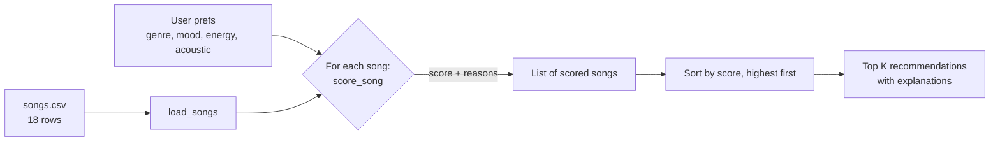

# 🎵 Music Recommender Simulation

## Project Summary

In this project you will build and explain a small music recommender system.

Your goal is to:

- Represent songs and a user "taste profile" as data
- Design a scoring rule that turns that data into recommendations
- Evaluate what your system gets right and wrong
- Reflect on how this mirrors real world AI recommenders

Replace this paragraph with your own summary of what your version does.

---

## How The System Works

Real-world platforms like Spotify and YouTube combine two approaches. **Collaborative filtering** learns from behavior across many users: if people who like the songs you like also like song X, X gets recommended to you, even if the system knows nothing about how X sounds. **Content-based filtering** looks at the item itself (genre, tempo, energy, mood, audio features) and recommends songs that are similar to what you already enjoy. Their signals include explicit feedback (likes, follows, playlist adds), implicit feedback (skips, replays, listen duration, time of day), and audio and metadata attributes. My simulation has no listening history from other users, so it is **purely content-based**. It prioritizes matching the user's preferred *vibe*: genre and mood first, then how close a song's energy is to the user's target, with acousticness as a tie-breaker.

**`Song` features used**

- `genre` (categorical): exact match with the user's favorite genre
- `mood` (categorical): exact match with the user's favorite mood
- `energy` (0–1): scored by closeness to the user's target energy
- `acousticness` (0–1): rewarded or penalized based on `likes_acoustic`
- `title`, `artist`, `id`: used for display only, not for scoring

**`UserProfile` features used**

- `favorite_genre`
- `favorite_mood`
- `target_energy` (0–1)
- `likes_acoustic` (True/False)

**Algorithm Recipe (Scoring Rule, one song)**

| Component | Points |
|---|---|
| Genre matches `favorite_genre` | +2.0 |
| Mood matches `favorite_mood` | +1.0 |
| Energy closeness: `1.5 × (1 − abs(song.energy − target_energy))` | 0 – 1.5 |
| Acoustic fit: `0.5 × acousticness` if `likes_acoustic`, else `0.5 × (1 − acousticness)` | 0 – 0.5 |

The maximum score is 5.0. Genre gets the largest weight because it is the strongest, most stable signal of taste. Mood is worth less because the same listener wants different moods at different times. The energy term uses *distance from the target*, so a song is rewarded for being close to what the user wants, not for simply being high or low energy.

**Ranking Rule (list of songs)**

Score every song in the catalog, sort from highest to lowest score, and return the top `k`. Each recommendation comes with the reasons that earned it points (for example, "genre match (+2.0), energy close to target (+1.41)").

**Catalog**

`data/songs.csv` has 18 songs. The 10 starter songs were expanded with 8 more (ids 11–18) covering genres and moods the starter file lacked: hip-hop/confident, classical/melancholic, metal/angry, country/nostalgic, r&b/romantic, edm/euphoric, reggae/uplifting and folk/sad.

**Example taste profile**

```python
user_prefs = {
    "favorite_genre": "pop",
    "favorite_mood": "happy",
    "target_energy": 0.8,
    "likes_acoustic": False,
}
```

Profile check: an "intense rock" profile (rock, intense, 0.9, not acoustic) ranks *Storm Runner* first (4.93). A "chill lofi" profile (lofi, chill, 0.38, acoustic) ranks *Library Rain* (4.88) and *Midnight Coding* (4.79) first. So the four preferences are enough to tell those two tastes apart. The profile is narrow in one way, though: it allows only one genre and one mood, so a listener who likes both rock *and* metal can't express that.

**Data flow**



Input (user prefs) → Process (loop over every song and score it alone) → Output (sort all scores, return the top K).

**Expected biases and limitations**

- **Genre dominates.** A genre match (+2.0) beats a perfect mood and energy fit from another genre. Great songs outside the favorite genre (for example, *Iron Tempest* for a rock fan) get buried.
- **Exact string matching.** `"indie pop"` doesn't count as `"pop"`, and `"metal"` doesn't count as `"rock"`, even though listeners would see them as close.
- **Uneven catalog.** Lofi has 3 songs and "chill" has 3, but most new genres have only 1. Lofi/chill users get a full top 5 of good matches, while a rock fan gets one strong match and then a steep drop.
- **Unused features.** `tempo_bpm`, `valence` and `danceability` are ignored, so two songs with the same energy but very different feel score the same.
- **No behavior data.** Without skips, likes or replays, the system can't learn or correct itself. It only knows the profile it's given.

---

## Getting Started

### Setup

1. Create a virtual environment (optional but recommended):

   ```bash
   python -m venv .venv
   source .venv/bin/activate      # Mac or Linux
   .venv\Scripts\activate         # Windows

2. Install dependencies

```bash
pip install -r requirements.txt
```

3. Run the app:

```bash
python -m src.main
```

### Running Tests

Run the starter tests with:

```bash
pytest
```

You can add more tests in `tests/test_recommender.py`.

---

## Sample Recommendation Output

Output of `python -m src.main` for the default pop/happy profile:

```
Loaded songs: 18

Profile: genre=pop, mood=happy, energy=0.8, likes_acoustic=False

Top recommendations:

1. Sunrise City by Neon Echo  [pop / happy]
   Score: 4.88 / 5.00
     - genre match (+2.00)
     - mood match (+1.00)
     - energy 0.82 vs target 0.80 (+1.47)
     - acoustic fit (+0.41)

2. Gym Hero by Max Pulse  [pop / intense]
   Score: 3.78 / 5.00
     - genre match (+2.00)
     - energy 0.93 vs target 0.80 (+1.30)
     - acoustic fit (+0.47)

3. Rooftop Lights by Indigo Parade  [indie pop / happy]
   Score: 2.77 / 5.00
     - mood match (+1.00)
     - energy 0.76 vs target 0.80 (+1.44)
     - acoustic fit (+0.33)

4. Concrete Crown by Kilo Verse  [hip-hop / confident]
   Score: 1.91 / 5.00
     - energy 0.78 vs target 0.80 (+1.47)
     - acoustic fit (+0.44)

5. Night Drive Loop by Neon Echo  [synthwave / moody]
   Score: 1.81 / 5.00
     - energy 0.75 vs target 0.80 (+1.42)
     - acoustic fit (+0.39)
```

**Screenshot or video** *(optional)*: <!-- Insert a screenshot or demo video link here -->

---

## Experiments You Tried

Full outputs and analysis are in the Evaluation section of [model_card.md](model_card.md).

- **Six profiles** were tested in `src/main.py`: three standard (High-Energy Pop, Chill Lofi, Deep Intense Rock) and three adversarial (Sad Banger, Ghost Genre, Acoustic EDM).
- **Weight shift (genre 2.0 → 1.0, energy 1.5 → 3.0):**
  - For High-Energy Pop, *Rooftop Lights* (happy) moved above *Gym Hero* (intense), which is more accurate.
  - Chill Lofi and Deep Intense Rock didn't change.
  - The conflicting profiles lost their genre/mood matches completely and became pure energy matches, which made them different but not better.
- **Biggest finding:** with the original weights, genre and mood labels beat the song's actual feel. A listener asking for sad songs at energy 0.9 gets a quiet folk song (energy 0.25) at #1.

---

## Limitations and Risks

Summarize some limitations of your recommender.

Examples:

- It only works on a tiny catalog
- It does not understand lyrics or language
- It might over favor one genre or mood

You will go deeper on this in your model card.

---

## Reflection

Read and complete `model_card.md`:

[**Model Card**](model_card.md)

Write 1 to 2 paragraphs here about what you learned:

- about how recommenders turn data into predictions
- about where bias or unfairness could show up in systems like this


